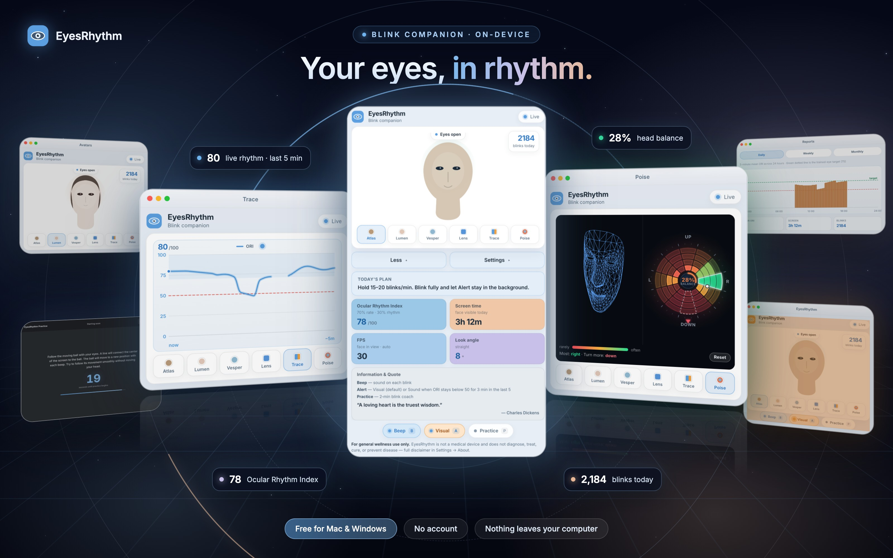

<h1 align="center">
  <br>
  EyesRhythm
</h1>

<p align="center">
  <strong>An on-device blink companion for long screen days.</strong><br>
  EyesRhythm uses your webcam to measure how often and how steadily you blink, and gently nudges you back to a healthy rhythm.
</p>

<p align="center">
  <a href="https://github.com/pranaycv/EyeRhythm/releases/latest"></a>
  
  
  <a href="LICENSE"></a>
</p>

<p align="center">
  <a href="https://eyesrhythm.com"><strong>Download</strong></a> ·
  <a href="#features">Features</a> ·
  <a href="#build-from-source">Build from source</a> ·
  <a href="docs/CODE_GUIDE.md">Code guide</a> ·
  <a href="CHANGELOG.md">Changelog</a>
</p>

<p align="center">
  
</p>

## Why EyesRhythm

Focused screen work lowers the spontaneous blink rate and makes blinking less complete and less regular. Over time this can contribute to dryness, fatigue, and blurred vision. It usually goes unnoticed until the eyes already hurt.

EyesRhythm runs quietly next to your work. It counts blinks with the built-in or USB webcam and turns rate and regularity into one score, the **Ocular Rhythm Index (ORI)**. It also helps you build a steadier habit of about 15–20 blinks per minute.

- **Private by design.** Everything runs on your computer. No account, no cloud, no analytics. Camera frames are never uploaded or recorded.
- **Free for macOS and Windows.** Official installers are available at [eyesrhythm.com](https://eyesrhythm.com) and on the [releases page](https://github.com/pranaycv/EyeRhythm/releases/latest).

> [!NOTE]
> EyesRhythm is a wellness companion, not a medical device. It is not intended to diagnose, treat, cure, or prevent any disease. If you have persistent eye discomfort or changes in vision, see an eye-care professional.

## Features

| | |
|---|---|
| **Ocular Rhythm Index** | A 0–100 score that combines blink rate (70%) and blink regularity (30%). |
| **Companion views** | Pick an avatar (Atlas, Lumen, or Vesper) that mirrors your blinks, a camera preview (Lens), a live five-minute ORI graph (Trace), or a head-direction dial (Poise). |
| **Poise** | Shows which directions your head has turned today in 30° slices, so the neck and shoulders get regular changes of position. |
| **Alerts** | Always on. Choose a quiet orange pulse (Visual, the default) or a short tone (Sound) when ORI stays below your threshold. You can also turn on a click for every blink. |
| **Practice** | A guided two-minute session that paces your blinks and eye movement. |
| **Reports** | Daily, weekly, and monthly charts of ORI and screen time. |
| **Smart camera use** | 30 fps while you are in view, 1 fps when you look away, and the camera turns off when you leave the desk. |
| **Multiple cameras** | Use one webcam, or Hybrid mode to combine every desk camera. |

### Keyboard shortcuts

| Key | Action |
|-----|--------|
| <kbd>B</kbd> | Beep on every counted blink |
| <kbd>A</kbd> | Switch the alert between Visual and Sound |
| <kbd>P</kbd> | Start or stop Practice |
| <kbd>D</kbd> | Switch between the compact and full dashboard |
| <kbd>W</kbd> | Show or hide the Settings and Reports panel |
| <kbd>C</kbd> | Switch to or from the Lens camera preview |

## Install

Download the installer for your computer from [eyesrhythm.com](https://eyesrhythm.com) or the [latest release](https://github.com/pranaycv/EyeRhythm/releases/latest).

- **macOS:** open the `.dmg` and drag EyesRhythm into Applications.
- **Windows:** run `EyesRhythm-Setup-<version>.exe`. It installs for your user account only and does not need administrator rights.

Allow camera access when the system asks. On macOS you can change this later in **System Settings → Privacy & Security → Camera**.

## Build from source

### Prerequisites

- Python 3.10–3.12 (3.11 recommended)
- Node.js 18 or later (to build the interface)
- A webcam and camera permission for your terminal or Python

### macOS and Linux

```bash
./for_mac/setup.sh     # create the virtual environment, install dependencies, build the UI
./for_mac/run.sh       # launch the desktop window
```

To open EyesRhythm when you log in, run `./for_mac/install_autostart.sh`. To turn that off, run `./for_mac/uninstall_autostart.sh`. See [`for_mac/README.md`](for_mac/README.md) for more, including how to build a standalone `.app`.

### Windows

See [`for_windows/README.md`](for_windows/README.md). It covers running from source, building the portable app and installer on a Windows PC, and using the **Build Windows app** GitHub Actions workflow.

### Development with hot reload

```bash
# Terminal 1: engine and local API
source EyeRhythm/bin/activate
python -m app.main --browser

# Terminal 2: React UI
cd frontend
npm install
npm run dev
```

Open the URL Vite prints. It proxies `/api` and `/ws` to the Python server on `127.0.0.1:8742`.

### Tests

```bash
python -m unittest discover -s tests
```

## How it works

```
Webcam ─▶ MediaPipe Face Landmarker ─▶ blink detector ─▶ engine ─▶ local API ─▶ React UI
                                        (blink_core/)    (app/)    (FastAPI,    (frontend/)
                                                                    WebSocket)
```

Regularity measures how even the gaps between blinks are:

```text
CV         = standard deviation of inter-blink gaps ÷ mean gap
Regularity = max(0, 100 − 100 × CV)
ORI        = 70% rate score + 30% regularity
```

Daily totals, ORI history, and preferences are stored as JSON in `~/.eyerhythm_blinkcounter/`. Nothing in that folder leaves your computer. See [`docs/CODE_GUIDE.md`](docs/CODE_GUIDE.md) for the frame pipeline, file formats, and settings.

## Project structure

```
├── app/              Camera engine, local API, desktop window
├── blink_core/       Blink detection and screen-time tracking
├── frontend/         React + TypeScript + Vite interface
├── models/           MediaPipe Face Landmarker model
├── assets/           App icons and the Inter font
├── tests/            Unit tests
├── tools/            Developer utilities (signal analysis, screenshot capture)
├── docs/             Code guide
├── for_mac/          macOS and Linux setup, run, and build scripts
├── for_windows/      Windows launchers, freeze, and installer scripts
├── website/          Marketing site (Astro)
├── licenses/         Full texts of third-party licenses
├── EyeRhythm.spec    PyInstaller configuration
└── run_app.py        Entry point for packaged builds
```

## Research

The rate and regularity measures are informed by published work on blinking during screen use, including:

- Johnston PR, Rodriguez J, Lane KJ, Ousler G, Abelson MB. *The interblink interval in normal and dry eye subjects.* Clinical Ophthalmology. 2013;7:253–259. [doi:10.2147/OPTH.S39104](https://doi.org/10.2147/OPTH.S39104)
- Cardona G, Argilés M, Pérez-Cabré E. *Loss of blink regularity and its impact on ocular surface exposure.* Diagnostics. 2023;13(14):2362. [doi:10.3390/diagnostics13142362](https://doi.org/10.3390/diagnostics13142362)
- Wang MTM, Power B, Xue AL, Craig JP. *Blink completeness and rate in dry eye disease: an investigator-masked, prospective registry-based, cross-sectional, prognostic study.* Contact Lens and Anterior Eye. 2025;48:102369. [doi:10.1016/j.clae.2025.102369](https://doi.org/10.1016/j.clae.2025.102369)

## Contributing

Bug reports and ideas are welcome. Please read [`CONTRIBUTING.md`](CONTRIBUTING.md) before opening an issue or pull request. To report a security issue, follow [`SECURITY.md`](SECURITY.md) instead of opening a public issue.

## License

EyesRhythm’s source code is licensed under the [PolyForm Noncommercial License 1.0.0](LICENSE). You may use, modify, and share it for any noncommercial purpose, provided you keep `LICENSE`, the required notice below, and [`THIRD_PARTY_NOTICES.md`](THIRD_PARTY_NOTICES.md). Commercial use is not permitted under this license.

Required Notice: Copyright Pranay Soni (https://github.com/pranaycv)

Third-party components keep their own licenses. Packaged builds include `LICENSE`, `THIRD_PARTY_NOTICES.md`, and the full texts in [`licenses/`](licenses/).

| Component | License |
|-----------|---------|
| MediaPipe and the Face Landmarker model | Apache 2.0 |
| OpenCV | Apache 2.0 |
| FFmpeg (inside the OpenCV wheel) | LGPLv2.1, shipped as a replaceable shared library |
| NumPy, Uvicorn, pywebview | BSD-3-Clause |
| FastAPI, Pydantic, React, Vite | MIT |
| Inter font | SIL Open Font License 1.1 |
| PyInstaller (build tool only) | GPL-2.0 with bootloader exception |

The Sound-mode alert tone (`alert.mp3`) is original to EyesRhythm. Practice quotations in `quotes.json` are limited to public-domain authors.

## Contact

Questions and feedback: [hello@eyesrhythm.com](mailto:hello@eyesrhythm.com) · Website: [eyesrhythm.com](https://eyesrhythm.com)
